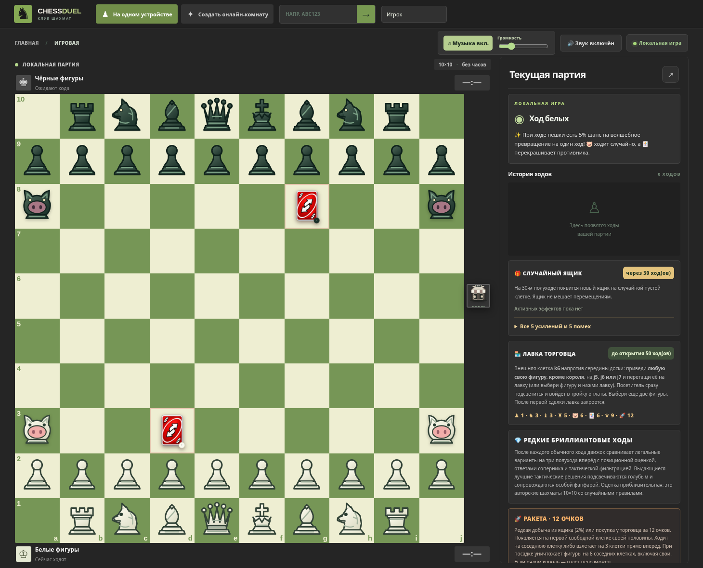

# CHESS DUEL 8.0 — Rocket Edition 🚀💎

Авторский вариант шахмат **10×10** для локальной партии или **онлайн 1 на 1** через код комнаты. Совместим с механиками 7.0: перетаскивание, шахматные часы, король/ферзь/слон/конь/ладья/пешка, свиньи, UNO, 5% магия пешек, сундуки каждые 30 полуходов, 10 эффектов, лавка k6 с 50-го полухода, музыка и 5 киноповторов по 3 секунды.



## Как запустить

Нужен **Node.js 20+**. В распакованной папке:

```bash
npm install
npm start
```

Перейдите на <http://localhost:3000>. Для игры с другом через интернет разверните сервер на Node.js-хостинге, поддерживающем Socket.IO/WebSocket. Комнаты и партии хранятся **в памяти сервера** — при перезагрузке они исчезают. Сайт не становится публичным сам по себе после локального запуска.

## 🚀 Новая фигура: ракета

Ракеты **нет на стартовой позиции**. Её можно получить двумя способами:

- **Лавка торговца k6** — обменять ровно три свои фигуры (посетитель входит в тройку) на ракету при суммарной ценности **не менее 12 очков**. Цены: пешка 1, конь/слон 3, ладья 5, свинья/UNO 6, ферзь 9, ракета 12. Король не продаётся. Лавка начинает работать с **50-го полухода**, закрывается после **первой сделки**.
- **Сундук на доске** — редкий **2%** шанс получить ракету вместо одного из 10 стандартных эффектов. Остальные 98% исходов делятся между пятью усилениями и пятью ослаблениями. Сундуки появляются каждые **30 полуходов**.

Ракета появляется на **первой доступной клетке домашней горизонтали** своей стороны, начиная с центра; если она занята, поиск продолжается на следующих горизонталях своей половины. Белые начинают поиск с 1-й, чёрные — с 10-й. Если свободной клетки нигде нет, покупка отклоняется; выпадение из сундука заменяется обычным эффектом.

**Два действия ракеты:**

1. **Обычный ход:** одна клетка в любую из восьми соседних сторон. Если там фигура соперника, возможен обычный захват.
2. **Взлёт:** нажмите ровно на **три клетки прямо вперёд**. Ракета перелетает промежуточные клетки (они могут быть заняты), но приземляется только на **пустую**. После посадки уничтожаются **все фигуры на восьми соседних клетках**, как вражеские, так и союзные. **Обоих королей нельзя задеть** — такой выстрел даже не предлагается системой допустимых ходов. Ракета остаётся на клетке посадки.

Срабатывают пламя, ударная волна, подсветка поражённых клеток и отдельный синтезированный звук. Полёт ракеты включён в систему ценных эпизодов реплея. **Клиент не может сам отправить список поражённых фигур:** его рассчитывает общий движок на сервере.

Ограничение: ракета доступна только из сундука или лавки; временная 5% магия пешки по-прежнему выбирает из прежнего набора фигур без короля и без ракеты.

## 💎 Улучшенные бриллиантовые ходы

В версии 7.0 оценка просчитывала 2 полухода и нередко отмечала обыкновенное взятие. В версии 8.0 действует **выборочный поиск на 3 полухода**: собственный ход, опасные ответы соперника, лучшие продолжения игрока.

- Позиционная оценка учитывает материал и относительную стоимость новых фигур, центр, продвижение пешек, изолированные/сдвоенные пешки, активность лёгких фигур, открытые вертикали ладей, безопасность короля и временные эффекты.
- Для ограничения задержки используется отсев кандидатов: до **8 перспективных стартовых вариантов** (плюс фактически сыгранный), до **4 сильных ответов**, до **3 продолжений**. Полного перебора всех 3-ходовых веток нет.
- 💎 выдаётся **очень выборочно**: ход должен быть лучшим из рассмотренных, тактически значимым (например, взятие важной фигуры или мат), существенно усиливать позицию (минимум +170 оценочных очков) и превосходить альтернативу минимум на 165 очков.
- Обычные тихие ходы, рядовые взятия пешек и случайные движения свиньи **не получают** бриллиант только за то, что они формально неплохие.

Это **эвристическая оценка**, а не доказательство математически оптимального хода. Механики случайных сундуков и магии пешек нельзя детерминированно предсказать на 3 шага вперёд, поэтому анализ исходит из текущей позиции без будущих бросков случайности. При награде запускаются голубая подсветка, частицы и специальная фанфара.

## ♟️ Обновлённое оформление

Ориентир — присланный пользователем пример: **большая шахматная доска** с зелёными и кремовыми клетками, тёмный фон, компактная навигация сверху и боковая чёрная панель матча. **Никакого тренера нет.** Поддержаны мобильные экраны; лавка находится снаружи напротив **k6** независимо от ориентации.

## ⚡ Более отзывчивый онлайн

- После нажатия легального хода браузер **сразу отображает предварительное положение фигуры**, не ожидая ответа сети. Пока подтверждение не пришло, второе действие отправить нельзя.
- Сервер авторитетно проверяет ходы, запускает рандом, обслуживает шах/мат/взрывы, затем рассылает настоящую позицию. Если ход отклонён или сеть недоступна — клиент откатывает предварительную картинку.
- Для сундуков и тумана войны предварительное раскрытие случайных событий намеренно отключено.
- **Существующие 100 DOM-клеток больше не создаются заново** при каждом обновлении: интерфейс повторно использует их, сохраняя изображения без изменений.
- Подключение пробует **WebSocket в приоритете**, а при его недоступности — резервный транспорт Socket.IO.

Скорость реальной онлайн-игры также зависит от задержки между устройствами и расположения Node.js-сервера. Тестирование в глобальной сети, на разных провайдерах и при реальном пинге пока не проводилось — эти оптимизации не гарантируют нулевую задержку.

## 🎞️ Пять повторов после матча

По окончании матча выбираются **до пяти реальных лучших моментов**. Каждый длится 3 секунды; один матч может содержать меньше пяти ходов. Используются сохранённые позиции до/после хода, выбор значимых событий (включая ракетный взрыв), замедленное перемещение, подсветка и музыка, включённая пользователем. В браузере это интерактивный повтор, **не видеофайл MP4**.

## 🎶 Музыка и авторские права

В `public/audio/background-loop.mp3` сохранён прикреплённый трек из предыдущих версий. Включается после первого хода (если браузер разрешает), воспроизводится по кругу; отдельно доступны выключение музыки, громкость и звуки эффектов. **Проверьте разрешение на публичное использование музыкальной записи перед публикацией сайта.**

## Тестирование

```bash
node --test tests/chess10.test.js     # работает без npm-пакетов
npm test                              # все тесты, включая онлайн, после npm install
```

Проверено при подготовке версии:

- **45 из 45** автоматических тестов движка — правила, ракета, защита короля, лутбокс, покупка, FEN, эвристика, история.
- Chromium: 100 клеток, крупная доска, ход пешки, подсветка запуска и взрыв ракеты, мобильное отображение без горизонтального переполнения.
- В Chromium отдельно смоделирован сетевой ответ: **мгновенный предварительный ход и откат после отказа** — ошибок JavaScript нет.
- **Интеграционные тесты двух настоящих Socket.IO-клиентов ещё не выполнялись**, поскольку установка npm-зависимостей в тестовой среде недоступна.

## Структура

- `public/chess10.js` — детерминированный движок шахмат 10×10 и эвристический анализ;
- `server.js` — онлайн-комнаты и серверная авторизация действий;
- `public/app.js` — интерфейс, оптимистичный онлайн, drag-and-drop, эффекты, музыка и реплеи;
- `public/styles.css`, `public/index.html` — оформление;
- `public/pieces/wt.svg`, `public/pieces/bt.svg` — новая белая и чёрная ракета;
- `public/audio/background-loop.mp3` — пользовательский аудиофайл;
- `tests/chess10.test.js`, `tests/online.test.js` — тесты движка и сетевой логики.
