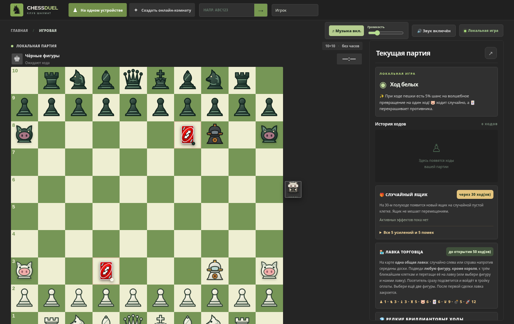

# 💣 CHESS DUEL 9.0 — Minefield Update

Полный проект авторских шахмат **10×10**: локальная партия и онлайн 1 на 1 через Socket.IO. Сохранены свиньи, карты UNO, 5% магия пешек, случайные сундуки, усиления, общая торговая лавка, одноразовые ракеты, оценка бриллиантовых ходов, киноповторы и пользовательская музыка.



## Запуск

Установите **Node.js 20+**. В корне проекта:

```bash
npm install
npm start
```

Откройте `http://localhost:3000`. Для игры с другого компьютера через интернет разместите проект на хостинге Node.js, поддерживающем WebSocket и Socket.IO. Это не статический сайт: сервер нужен для комнат, времени, случайных исходов, мин и проверки ходов. Данные партий хранятся в памяти сервера и пропадают при перезапуске.

## Что изменено в версии 9.0

### 🚀 Одноразовая ракета

- Её всё так же можно купить в лавке за **12 очков** или получить с шансом **2%** из сундука.
- Ракета делает обычный шаг на соседнюю клетку либо взлетает на три клетки **строго вперёд**.
- При посадке взрыв убирает все фигуры в восьми соседних клетках, включая свои. **Сама ракета тоже исчезает** — она одноразовая.
- Пуск запрещён, если взрыв задел бы любого короля. Взрыв рассчитывает сервер.

### ⏳ Предходы в онлайне

Пока ходит противник, можно выбрать **свою фигуру**, указать клетку мышью, нажатием или перетаскиванием и поставить один ход в очередь. Он подсвечивается голубым. Можно **отменить** кнопкой или **заменить** новым. Поставленную на предход свинью сервер в следующий ход передвинет случайно, как обычно. Как только сервер передаст очередь, клиент **повторно проверит легальность** и отправит ход. Если позиция изменилась и ход невозможен, он отменится — ходы не принимаются заранее сервером в обход очереди.

После обновления онлайн-состояния анимация показывается **обоим** игрокам: перемещение фигур отображается с отдельным летящим спрайтом и продолжается дольше, чем в 8.0. Сохранена оптимистичная отрисовка собственного хода. Пинг и фактическая задержка между сетями зависят от хостинга.

### 🏪 Одна общая лавка

Лавка **одна на всю партию** и всегда в **одном месте**: в начале игры случайно выбирается левая или правая сторона игрового поля, напротив шестой горизонтали. Белые и чёрные видят один и тот же магазин (в перевёрнутой ориентации он отображается зеркально). Он открывается на **50-м полуходе** и закрывается после **первой сделки**. Входом служит одна из трёх крайних клеток рядом с магазином: `a5–a7` слева или `j5–j7` справа. Посетитель автоматически считается одной из трёх сдаваемых фигур. Короля сдавать нельзя. Цены сохранены, к ним добавлен **минёр — 5 очков**.

### ✨ Постоянная магия на последней горизонтали

При каждом выполненном ходе обычной пешки шанс превращения остаётся **5%**. Временное превращение обычно заканчивается после следующего хода владельца. Но если уже превращённая магией фигура **дошла до противоположного края**, новая форма **сохраняется навсегда** и не перекручивается повторно. Обычное превращение пешки на последней горизонтали также постоянное. Короля случайно получить нельзя. Минёр может выпасть от магии только если у игрока ещё нет минёра.

### 💣 Новый минёр и мины

- В стартовой расстановке **один белый минёр на h3** и **один чёрный на h8**. В движке запрещены дополнительные минёры одной команды одновременно; в лавке нельзя получить второго.
- Ходит на **одну соседнюю пустую клетку** в любом направлении, словно король, но **не может бить фигуры или объявлять шах**.
- Другой вариант действия: выбрать **ровно две клетки** в одном из восьми направлений от минера и **поставить мину** на свободное поле. Промежуточная клетка не обязана быть свободной. Установка расходует ход, но сам минёр остаётся на месте.
- Мина действует **семь последующих завершённых полуходов** (действия обоих игроков суммируются). Счётчик отображается на доске; возможны несколько активных мин.
- Если **вражеская фигура** входит на мину, фигура уничтожается, мина исчезает, воспроизводятся эффект взрыва и звук. Своя фигура мину не активирует.
- **Короля подрывать нельзя:** ему не разрешается войти на вражескую мину, включая рокировку через опасное поле. На короля минёр не нападает.

Все мины и их таймеры сериализованы в состоянии партии, поэтому онлайн-сервер и оба клиента видят согласованную позицию; клиент не выбирает жертв самостоятельно.

## Другие механики

Режим использует стандартные фигуры плюс свиней, UNO, ракету и минера. Сундук появляется каждые **30 полуходов** и выдаёт один из пяти баффов, пяти ослаблений либо редкую ракету. UNO-карта ходит на одну клетку вперёд и может на пять ходов перекрасить фигуру соперника. Бриллиантовые ходы определяются эвристическим выборочным анализом на три полухода, **не гарантируют оптимальность**; пять 3-секундных повторов доступны по окончании партии.

Музыкальная композиция, предоставленная пользователем, сохранена в `public/audio/background-loop.mp3`. Есть настройка громкости и повтор. Если браузер блокирует воспроизведение до взаимодействия, нажмите кнопку музыки вручную. Для публичного размещения записи проверьте права на использование.

## Проверки

```bash
node --test tests/chess10.test.js
npm test
```

- **52 теста** движка проходят без npm-зависимостей: базовые ходы, UNO, свиньи, магия, торговля, ракетные взрывы, семь полуходов мины, запрет взрыва короля, одна фигура минёра, постоянная эволюция.
- В Chromium проверены 100 клеток, SVG-минёры, выбор клетки мины, её срабатывание, одноразовый взрыв ракеты, общая лавка слева, мобильная вёрстка без горизонтального переполнения, отмена/замена предхода и анимация входящего хода. Для онлайн-предходов использована имитация сетевых сообщений.
- **Полный тест двух настоящих Socket.IO-клиентов выполнить не удалось**, поскольку в тестовой среде реестр npm был недоступен. Тестовый файл `tests/online.test.js` включён, и после `npm install` его можно запустить командой `npm test`.

## Структура

- `public/chess10.js` — общий игровой движок, FEN, мины, ракетные взрывы и торговая лавка;
- `server.js` — серверные комнаты и подтверждение действий;
- `public/app.js` — доска, предходы, анимации, звуки, диалоги и киноповторы;
- `public/styles.css` и `public/index.html` — адаптивный сайт;
- `public/pieces/wm.svg` и `public/pieces/bm.svg` — новые SVG-минёры;
- `public/audio/background-loop.mp3` — пользовательский трек;
- `tests` — автоматические тесты.
